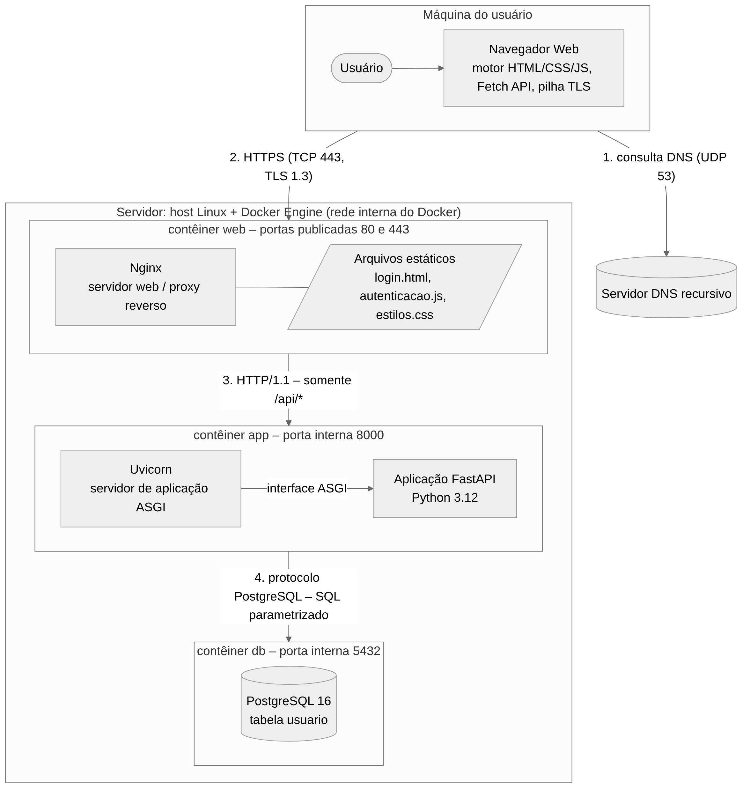

# 1 Ambiente operacional da aplicação Web

Esta seção descreve o ambiente operacional necessário para executar o software de autenticação no domínio Web. O ambiente é composto por softwares de apoio que se distribuem entre a máquina do usuário e o servidor, e que cooperam por meio de protocolos padronizados. A [Seção 1.1](#11-visão-geral-e-componentes-do-ambiente) identifica esses softwares; a [Seção 1.2](1.2-inicializacao.md#12-invocação-dos-servidores-e-inicialização-do-ambiente) descreve como cada um é invocado na inicialização do ambiente; a [Seção 1.3](1.3-processamento.md#13-processamento-de-uma-requisição-web) descreve, passo a passo, o processamento de uma requisição e os resultados gerados; e a [Seção 1.4](1.4-protocolos.md#14-protocolos-e-formatos-utilizados) resume os protocolos e formatos envolvidos.

## 1.1 Visão geral e componentes do ambiente

> **Item de informação IT-1.1** · Autoria: Júlia de Souza Nascimento · Revisão: Kesley Soares da Silva

Uma aplicação Web segue o estilo arquitetural cliente-servidor: o cliente (navegador) solicita recursos identificados por URL e o servidor os produz e devolve por meio do protocolo HTTP, sem que o servidor mantenha estado de conversação entre requisições [FIELDING, 2000]. Na prática, o "servidor" não é um único programa, mas uma cadeia de softwares especializados. Neste projeto, adota-se a separação clássica entre **servidor web**, responsável pela comunicação HTTP com a Internet e pela entrega de conteúdo estático, e **servidor de aplicação**, responsável por executar o código que implementa a regra de negócio [TANENBAUM; FEAMSTER; WETHERALL, 2021]. A Figura 1 mostra os componentes e as conexões entre eles.

**Figura 1 – Ambiente operacional da aplicação Web de autenticação**

*Fonte: elaborada pelos autores (2026), com a ferramenta Mermaid [MERMAID, 2026].*

A Tabela 2 descreve o papel de cada software de apoio, a forma como é invocado e o resultado que produz. O detalhamento da invocação está na [Seção 1.2](1.2-inicializacao.md#12-invocação-dos-servidores-e-inicialização-do-ambiente) e o encadeamento dos resultados durante uma requisição está na [Seção 1.3](1.3-processamento.md#13-processamento-de-uma-requisição-web).

**Tabela 2 – Softwares de apoio do ambiente operacional**

| Software | Papel no ambiente | Forma de invocação | Resultado gerado |
|---|---|---|---|
| Navegador Web (Chrome, Firefox, Edge ou Safari) | Cliente HTTP; interpreta HTML, CSS e JavaScript; executa a pilha TLS; renderiza a interface | Pelo usuário, ao digitar a URL ou seguir um link; pelo código JavaScript, via Fetch API | Página renderizada; requisições HTTP; exibição do resultado da autenticação |
| Resolvedor e servidor DNS | Traduz o nome de domínio em endereço IP | Pelo sistema operacional do cliente, a pedido do navegador | Endereço IP do servidor (registro A ou AAAA) |
| Sistema operacional (Linux) e pilha TCP/IP | Gerencia processos, sockets e interfaces de rede | Pelos servidores, via chamadas de sistema (`socket`, `bind`, `listen`, `accept`) | Conexões TCP estabelecidas e portas em escuta |
| Docker Engine e Docker Compose | Isola e orquestra os servidores em contêineres | Pelo operador: `docker compose up -d` | Contêineres `web`, `app` e `db` em execução, em rede interna própria |
| Nginx | Servidor web e proxy reverso: termina TLS, entrega arquivos estáticos, encaminha `/api/` ao servidor de aplicação, aplica limite de taxa e cabeçalhos de segurança | Pelo contêiner, com `nginx -g 'daemon off;'`; a cada requisição, pelo navegador | Respostas HTTP com arquivos estáticos; repasse da requisição de API; registro em `access.log` |
| Uvicorn | Servidor de aplicação ASGI: converte a mensagem HTTP em chamada à aplicação Python e a resposta da aplicação em mensagem HTTP | Pelo contêiner, com `uvicorn app.principal:app --host 0.0.0.0 --port 8000 --workers 2`; a cada requisição, pelo Nginx | Execução da aplicação; resposta HTTP com corpo JSON |
| Aplicação FastAPI (Python 3.12) | Código do domínio: valida a entrada, consulta o usuário, compara a senha e decide a autenticação | Pelo Uvicorn, por meio da interface ASGI | Objeto de identidade (sucesso) ou erro de autenticação (falha) |
| PostgreSQL 16 | Sistema gerenciador de banco de dados que mantém o repositório de usuários | Pelo contêiner, com o processo `postgres`; a cada consulta, pela aplicação | Linha do usuário encontrada ou conjunto vazio |

*Fonte: elaborada pelos autores (2026), com base em [NGINX, 2026], [ENCODE, 2026], [ASGI, 2026], [POSTGRESQL, 2026] e [DOCKER, 2026].*

A distinção entre servidor web e servidor de aplicação é essencial para entender o processamento. O Nginx é otimizado para lidar com muitas conexões simultâneas, criptografia e arquivos estáticos, mas não executa código Python [NGINX, 2026]. O Uvicorn, por sua vez, implementa a especificação ASGI (*Asynchronous Server Gateway Interface*), que define como um servidor entrega eventos HTTP a uma aplicação Python e recebe dela a resposta [ASGI, 2026; ENCODE, 2026]. Assim, a aplicação FastAPI não abre sockets nem interpreta bytes HTTP: ela recebe um objeto de requisição já estruturado e devolve um objeto de resposta.
