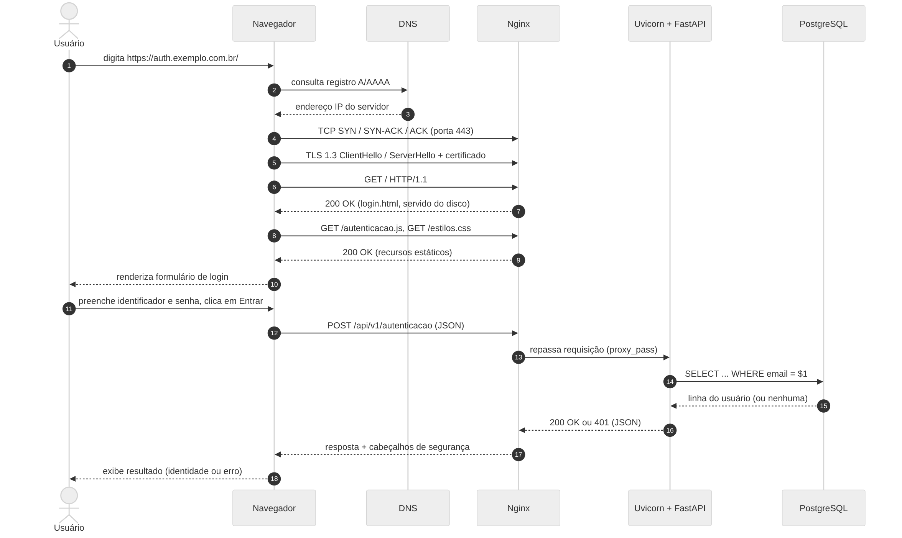

[1.3-processamento.md](https://github.com/user-attachments/files/33991080/1.3-processamento.md)
## 1.3 Processamento de uma requisição Web

> **Item de informação IT-1.3** · Autoria: Verônica Ribeiro Oliveira Palmeira · Revisão: Júlia de Souza Nascimento  
> Referências do item: [[MERMAID, 2026](../referencias.md#ref-mermaid2026)]; [[MOCKAPETRIS, 1987](../referencias.md#ref-mockapetris1987)]; [[TANENBAUM; FEAMSTER; WETHERALL, 2021](../referencias.md#ref-tanenbaum2021)]; [[EDDY, 2022](../referencias.md#ref-rfc9293)]; [[RESCORLA, 2018](../referencias.md#ref-rfc8446)]; [[FIELDING; NOTTINGHAM; RESCHKE, 2022a](../referencias.md#ref-rfc9110)]; [[FIELDING; NOTTINGHAM; RESCHKE, 2022b](../referencias.md#ref-rfc9112)]; [[NGINX, 2026](../referencias.md#ref-nginx2026)]; [[WHATWG, 2026b](../referencias.md#ref-whatwghtml2026)]; [[MDN, 2026](../referencias.md#ref-mdn2026)]; [[WHATWG, 2026a](../referencias.md#ref-whatwgfetch2026)]; [[ASGI, 2026](../referencias.md#ref-asgi2026)] · Apoio de IA: [[ANTHROPIC, 2026](../referencias.md#ref-anthropic2026)]

Esta subseção descreve o caminho completo de uma interação do usuário com o software, desde a digitação da URL até a exibição do resultado da autenticação. O processamento divide-se em duas fases: (a) carregamento da página de login, composta apenas por recursos estáticos; e (b) envio das credenciais, que é a única requisição dinâmica do sistema. A Figura 2 mostra a ordem das mensagens trocadas, e a Tabela 4 detalha a invocação e o resultado de cada etapa.

**Figura 2 – Sequência de mensagens no ambiente durante o uso do software**



*Fonte: elaborada pelos autores (2026), com a ferramenta Mermaid [[MERMAID, 2026](../referencias.md#ref-mermaid2026)].*

### 1.3.1 Fase A: carregamento da página de login

**Resolução de nome.** Ao receber a URL `https://auth.exemplo.com.br/`, o navegador separa o esquema (`https`), o nome do servidor (`auth.exemplo.com.br`) e o caminho (`/`). Como a comunicação ocorre por endereço IP, o navegador solicita ao resolvedor do sistema operacional a tradução do nome. O resolvedor consulta o cache local e, se necessário, um servidor DNS recursivo, que percorre a hierarquia de servidores (raiz, `.br`, `exemplo.com.br`) até obter o registro A ou AAAA [[MOCKAPETRIS, 1987](../referencias.md#ref-mockapetris1987); [TANENBAUM; FEAMSTER; WETHERALL, 2021](../referencias.md#ref-tanenbaum2021)]. O resultado é o endereço IP do host onde executa o Nginx.

**Conexão de transporte e segurança.** De posse do endereço, o navegador abre uma conexão TCP com a porta 443 por meio do *three-way handshake* (SYN, SYN-ACK, ACK), que garante entrega ordenada e confiável dos bytes [[EDDY, 2022](../referencias.md#ref-rfc9293)]. Sobre essa conexão, executa o *handshake* TLS 1.3: o navegador envia o `ClientHello` com as cifras suportadas e o nome do servidor (SNI); o Nginx responde com `ServerHello` e seu certificado; o navegador valida a cadeia de certificação e o nome, e ambos derivam chaves de sessão [[RESCORLA, 2018](../referencias.md#ref-rfc8446)]. O resultado é um canal cifrado e autenticado, que impede a leitura e a alteração das credenciais em trânsito.

**Requisição e resposta HTTP do documento.** O navegador envia a requisição `GET`, conforme a semântica de HTTP [[FIELDING; NOTTINGHAM; RESCHKE, 2022a](../referencias.md#ref-rfc9110)] e a sintaxe de mensagem de HTTP/1.1 [[FIELDING; NOTTINGHAM; RESCHKE, 2022b](../referencias.md#ref-rfc9112)]:

```http
GET / HTTP/1.1
Host: auth.exemplo.com.br
Accept: text/html
User-Agent: Mozilla/5.0 (...)
```

O processo trabalhador do Nginx aceita a conexão, interpreta a linha de requisição e os cabeçalhos, seleciona o bloco `location /` e, como o caminho é `/`, aplica a diretiva `index` e lê o arquivo `login.html` do disco [[NGINX, 2026](../referencias.md#ref-nginx2026)]. A resposta gerada é:

```http
HTTP/1.1 200 OK
Content-Type: text/html; charset=utf-8
Content-Length: 1532
Strict-Transport-Security: max-age=31536000
Content-Security-Policy: default-src 'self'

<!DOCTYPE html> ... <form id="form-login"> ... </form>
<script src="/autenticacao.js" defer></script>
```

Nenhuma linha de código da aplicação Python é executada nessa fase: todo o processamento é feito pelo servidor web.

**Renderização.** O motor do navegador analisa o HTML e constrói a árvore DOM; ao encontrar referências a `estilos.css` e `autenticacao.js`, emite novas requisições `GET`, atendidas da mesma forma pelo Nginx. Em seguida, combina DOM e regras CSS, calcula o *layout* e pinta a página [[WHATWG, 2026b](../referencias.md#ref-whatwghtml2026); [MDN, 2026](../referencias.md#ref-mdn2026)]. O script `autenticacao.js` é executado após a análise do documento e registra um tratador para o evento de envio do formulário. O resultado da fase A é o formulário de login exibido ao usuário.

### 1.3.2 Fase B: envio e verificação das credenciais

**Invocação pelo cliente.** Quando o usuário clica em "Entrar", o tratador de evento impede o envio tradicional do formulário, lê os campos e invoca a Fetch API [[WHATWG, 2026a](../referencias.md#ref-whatwgfetch2026)]. Como a página e a API estão na mesma origem (mesmo esquema, nome e porta), não há necessidade de CORS. A requisição gerada é:

```http
POST /api/v1/autenticacao HTTP/1.1
Host: auth.exemplo.com.br
Content-Type: application/json
Accept: application/json

{"identificador": "julia@exemplo.com.br", "senha": "••••••••"}
```

**Processamento no servidor web.** O Nginx seleciona o bloco `location /api/`, verifica o limite de taxa do endereço de origem (se excedido, responde `429 Too Many Requests` sem acionar a aplicação), acrescenta os cabeçalhos `X-Forwarded-For` e `X-Forwarded-Proto` e reencaminha a mensagem, agora sem TLS, para `http://app:8000` [[NGINX, 2026](../referencias.md#ref-nginx2026)].

**Processamento no servidor de aplicação.** O Uvicorn lê os bytes da conexão, interpreta a mensagem HTTP e constrói o dicionário `scope` da especificação ASGI (método, caminho, cabeçalhos) e os eventos `http.request` com o corpo [[ASGI, 2026](../referencias.md#ref-asgi2026)]. Em seguida, invoca a aplicação FastAPI, que seleciona a rota pelo método e caminho, converte o JSON em objeto de entrada validado e chama o serviço de autenticação. O serviço consulta o PostgreSQL com SQL parametrizado, compara a senha informada com o *hash* armazenado e decide o resultado. O desenho detalhado dessa lógica está nas seções [2.3](../02-projeto/2.3-componentes.md#23-desenho-detalhado-de-componentes) e [2.6](../02-projeto/2.6-comportamento.md#26-comportamento-dinâmico). A aplicação devolve ao Uvicorn os eventos `http.response.start` (código e cabeçalhos) e `http.response.body` (corpo JSON), que são serializados como mensagem HTTP.

**Retorno ao cliente.** O Nginx recebe a resposta, adiciona os cabeçalhos de segurança, cifra a mensagem no canal TLS e a entrega ao navegador. Ao final, registra uma linha no `access.log`, por exemplo:

```text
203.0.113.7 - - [26/Oct/2026:15:44:10 -0300] "POST /api/v1/autenticacao HTTP/1.1" 200 118 "-" "Mozilla/5.0"
```

O código JavaScript verifica o código de status: em `200`, lê o objeto de identidade e exibe a mensagem de sucesso; em `401`, exibe a mensagem genérica de falha. O contrato exato das respostas está na [Seção 2.5](../02-projeto/2.5-api.md#25-contrato-da-api).

**Tabela 4 – Etapas do processamento, invocação e resultados**

| Etapa | Quem invoca | Quem processa | Resultado gerado |
|---|---|---|---|
| 1. Resolução de nome | Navegador | Resolvedor do SO e servidor DNS | Endereço IP do servidor |
| 2. Conexão TCP | Navegador | Pilha TCP/IP do cliente e do servidor | Conexão confiável na porta 443 |
| 3. *Handshake* TLS | Navegador | Navegador e Nginx | Canal cifrado; servidor autenticado por certificado |
| 4. `GET /` e recursos | Navegador | Nginx (arquivos estáticos) | `200 OK` com HTML, CSS e JavaScript |
| 5. Renderização | Navegador | Motor HTML/CSS e JavaScript | Formulário de login exibido |
| 6. `POST /api/v1/autenticacao` | `autenticacao.js` (Fetch API) | Nginx (proxy reverso, limite de taxa) | Requisição repassada ao Uvicorn ou `429` |
| 7. Execução da aplicação | Uvicorn (ASGI) | FastAPI e serviço de autenticação | Decisão de autenticação |
| 8. Consulta ao repositório | Aplicação | PostgreSQL | Registro do usuário ou conjunto vazio |
| 9. Resposta | Aplicação, Uvicorn, Nginx | Navegador | `200` com identidade ou `401` com erro; linha no `access.log` |

*Fonte: elaborada pelos autores (2026).*
