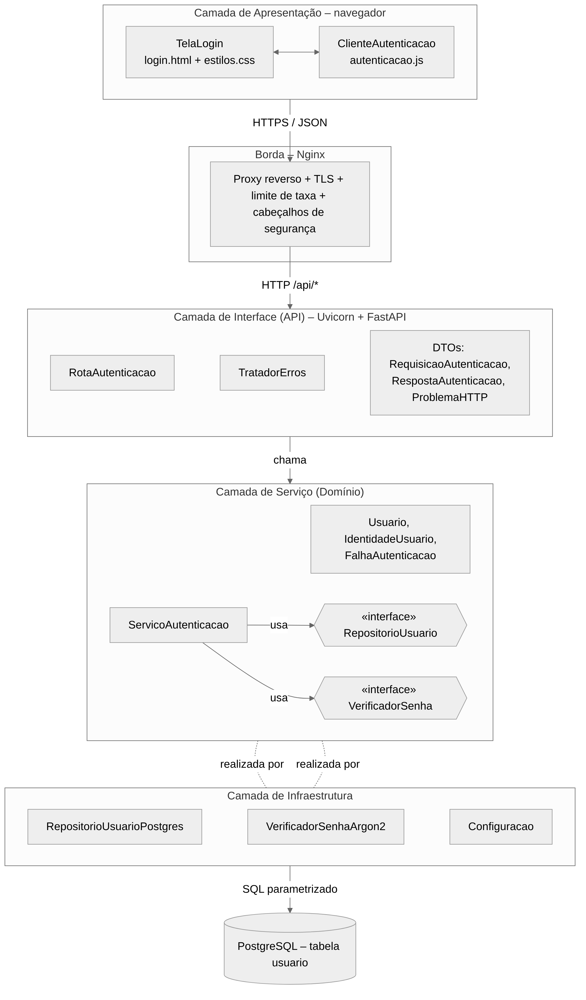

## 2.2 Arquitetura da solução

> **Item de informação IT-2.2** · Autoria: Verônica Ribeiro Oliveira Palmeira · Revisão: Kesley Soares da Silva

A arquitetura é descrita por três visões complementares, conforme a prática de documentação por visões de [[BASS; CLEMENTS; KAZMAN, 2021](../referencias.md#ref-bass2021)]: a visão de implantação, que mostra em que processos e máquinas o software executa; a visão de componentes e conectores, que mostra os elementos em tempo de execução e suas interações; e a visão de módulos, que mostra como o código é organizado. A visão de implantação coincide com o ambiente operacional já descrito na Figura 1 e não é repetida aqui.

### 2.2.1 Estilos arquiteturais adotados

A solução combina dois estilos. No nível do sistema, adota-se o estilo **cliente-servidor sem estado** da Web [[FIELDING, 2000](../referencias.md#ref-fielding2000)]: cada requisição contém as credenciais necessárias para sua autenticação, sem depender de uma sessão de autenticação mantida pelo servidor entre chamadas. Os dados dos usuários permanecem persistidos no PostgreSQL, e o controle de tentativas é realizado pelo Nginx. Assim, os processos do Uvicorn não precisam compartilhar sessões de autenticação. No nível da aplicação, adota-se a **arquitetura em camadas** com inversão de dependência: a camada de serviço, que contém a regra de autenticação, define interfaces para o acesso a dados e para a verificação de senha, e a camada de infraestrutura as implementa [[MARTIN, 2017](../referencias.md#ref-martin2017)]. Os padrões *Service Layer*, *Repository* e *Data Transfer Object* de [[FOWLER, 2002](../referencias.md#ref-fowler2002)] dão nome aos elementos de cada camada. A Figura 3 apresenta a visão de componentes e conectores.

**Figura 3 – Visão de componentes e conectores da solução**



*Fonte: elaborada pelos autores (2026), com a ferramenta Mermaid [[MERMAID, 2026](../referencias.md#ref-mermaid2026)].*

As camadas têm as seguintes responsabilidades:

- **Apresentação (navegador):** exibe o formulário, envia as credenciais e mostra o resultado. Não contém regra de autenticação.
- **Borda (Nginx):** concentra preocupações transversais de comunicação, como TLS, limite de taxa e cabeçalhos de segurança, sem conhecer a regra de negócio.
- **Interface (API):** traduz HTTP em chamadas ao serviço e resultados ou exceções do serviço em respostas HTTP. É a única camada que conhece códigos de status e formatos JSON.
- **Serviço (domínio):** implementa as quatro etapas do domínio (RF01 a RF06). Não conhece HTTP, SQL nem Argon2id.
- **Infraestrutura:** implementa o acesso ao PostgreSQL e o algoritmo de *hash*, e lê a configuração.

### 2.2.2 Decisões arquiteturais

A Tabela 9 registra as principais decisões, as alternativas consideradas e a justificativa, de modo que futuras alterações possam ser avaliadas contra os motivos originais [[BASS; CLEMENTS; KAZMAN, 2021](../referencias.md#ref-bass2021)].

**Tabela 9 – Registro de decisões arquiteturais**

| ID | Decisão | Alternativas consideradas | Justificativa |
|---|---|---|---|
| DA01 | Separar servidor web (Nginx) e servidor de aplicação (Uvicorn) | Expor o Uvicorn diretamente | O Nginx trata TLS, estáticos e limite de taxa com eficiência e isola a aplicação da rede externa (RNF01, RNF03). |
| DA02 | Servir página e API na mesma origem | Front-end em domínio separado | Dispensa CORS e reduz a superfície de configuração. |
| DA03 | Python 3.12 com FastAPI e Uvicorn | Node.js com Express; Java com Spring Boot | Validação declarativa de entrada, documentação OpenAPI automática e baixa quantidade de código para um escopo pequeno. |
| DA04 | PostgreSQL como repositório | SQLite; arquivo JSON | Restrições de unicidade, acesso concorrente e separação em processo próprio, coerente com um ambiente Web real. |
| DA05 | Inversão de dependência entre serviço e infraestrutura | Serviço acessando o banco diretamente | Permite testar o serviço com implementações em memória e trocar banco ou algoritmo de *hash* (RNF07). |
| DA06 | API sem estado, sem emissão de sessão | Emitir cookie de sessão ou *token* | O enunciado restringe o escopo à verificação de credenciais; o retorno é apenas a identidade. |

*Fonte: elaborada pelos autores (2026).*

### 2.2.3 Visão de módulos

A organização do código no repositório reflete as camadas da Figura 3. Cada pacote Python corresponde a uma camada, e as dependências entre pacotes só ocorrem no sentido `api → servico ← infraestrutura`:

```text
/
├── docker-compose.yml
├── web/                        # contêiner Nginx
│   ├── nginx.conf
│   └── html/  login.html  autenticacao.js  estilos.css
├── app/                        # contêiner Uvicorn + FastAPI
│   ├── principal.py            # cria o objeto FastAPI e injeta dependências
│   ├── api/       rota_autenticacao.py  tratador_erros.py  dtos.py
│   ├── servico/   servico_autenticacao.py  modelos.py  portas.py
│   └── infraestrutura/  repositorio_postgres.py  verificador_argon2.py  configuracao.py
├── db/            01-esquema.sql  02-carga-teste.sql
└── testes/        test_servico.py  test_api.py
```

O módulo `principal.py` é o único que conhece todas as camadas: ele instancia as implementações concretas da infraestrutura e as entrega ao serviço, que por sua vez é entregue à rota.
