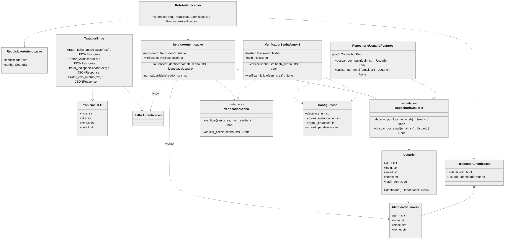

## 2.3 Desenho detalhado de componentes

> **Item de informação IT-2.3** · Autoria: Kesley Soares da Silva · Revisão: Júlia de Souza Nascimento  

Esta subseção especifica cada componente da Figura 3 em nível suficiente para a implementação. A Figura 4 apresenta o diagrama de classes, na notação da UML 2.5.1 (OMG, 2017), dos componentes que executam no servidor de aplicação. Interfaces aparecem com o estereótipo «interface»; setas tracejadas com triângulo indicam realização, e setas tracejadas simples indicam dependência de uso.

**Figura 4 – Diagrama de classes da aplicação**



*Fonte: elaborada pelos autores (2026), com a ferramenta Mermaid (Mermaid, 2026). Apoio de IA: (Anthropic, 2026).*

### 2.3.1 Componentes da camada de interface (API)

**RequisicaoAutenticacao** (DTO de entrada). Modelo Pydantic com os campos `identificador` (texto, 1 a 254 caracteres) e `senha` (`SecretStr`, 1 a 128 caracteres). O tipo `SecretStr` impede que a senha apareça em representações textuais e logs (Ramírez, 2026). Campos adicionais no JSON são rejeitados.

**RespostaAutenticacao** (DTO de saída). Contém `autenticado` (sempre `true`) e `usuario`, do tipo `IdentidadeUsuario`, definido na camada de serviço e composto por `id`, `login`, `email` e `nome` (RF05, RN05).

**ProblemaHTTP** (DTO de erro). Estrutura do formato *Problem Details* com `type`, `title`, `status` e `detail`, usada em todas as respostas de erro (ver [Seção 2.5](2.5-api.md#25-contrato-da-api)).

**RotaAutenticacao.** Define o *endpoint* `POST /api/v1/autenticacao`. A operação é descrita na Tabela 10.

**Tabela 10 – Especificação da operação RotaAutenticacao.autenticar**

| Elemento | Especificação |
|---|---|
| Assinatura | `autenticar(req: RequisicaoAutenticacao) -> RespostaAutenticacao` |
| Pré-condição | Corpo JSON já validado pelo FastAPI contra `RequisicaoAutenticacao`. |
| Processamento | Chama `ServicoAutenticacao.autenticar(req.identificador, req.senha.get_secret_value())` e encapsula o retorno em `RespostaAutenticacao`. |
| Pós-condição (sucesso) | Resposta `200` com `Content-Type: application/json` e `Cache-Control: no-store`. |
| Exceções | `FalhaAutenticacao` e erros inesperados são propagados para o `TratadorErros`. |

*Fonte: elaborada pelos autores (2026).*

**TratadorErros.** Conjunto de tratadores de exceção registrados no objeto FastAPI (Ramírez, 2026). Converte `FalhaAutenticacao` em `401`, erros de validação de entrada em `400`, indisponibilidade do banco de dados em `503` e qualquer outra exceção em `500`, sempre com corpo `ProblemaHTTP` e sem expor detalhes internos (mensagens de banco, *stack trace*). Também trata as exceções HTTP do framework: para `405`, produz o corpo `ProblemaHTTP` e preserva `Allow: POST`. O FastAPI não rejeita sozinho um `Content-Type` diferente de JSON; o `MiddlewareTipoConteudo`, executado antes da rota `POST /api/v1/autenticacao`, verifica o cabeçalho e gera `415` quando necessário, e o `TratadorErros` converte essa exceção em `ProblemaHTTP`. O erro interno é registrado no log do servidor com um identificador de correlação.

### 2.3.2 Componentes da camada de serviço

**Usuario** (entidade). Representa o registro do repositório: `id`, `login`, `email`, `nome` e `hash_senha`. O método `identidade()` devolve um `IdentidadeUsuario` sem o *hash* (RN05).

**IdentidadeUsuario** (objeto de valor de saída do serviço). Contém apenas `id`, `login`, `email` e `nome`. É o tipo retornado por `ServicoAutenticacao`; a camada de API o reaproveita no campo `usuario` de `RespostaAutenticacao`, sem que o serviço dependa de um DTO da API.

**FalhaAutenticacao** (exceção de domínio). Não carrega o motivo da falha, para que nenhuma camada possa distinguir usuário inexistente de senha incorreta (RN04).

**RepositorioUsuario** e **VerificadorSenha** (interfaces, ou portas). Definidas como `typing.Protocol` no módulo `servico/portas.py`. São o contrato que a camada de infraestrutura deve cumprir.

**ServicoAutenticacao.** Implementa a regra de autenticação. Recebe as duas portas no construtor (injeção de dependência). A Tabela 11 especifica a operação principal; o algoritmo completo está na Figura 7.

**Tabela 11 – Especificação da operação ServicoAutenticacao.autenticar**

| Elemento | Especificação |
|---|---|
| Assinatura | `autenticar(identificador: str, senha: str) -> IdentidadeUsuario` |
| Pré-condição | `identificador` e `senha` não vazios e dentro dos limites da RN03. |
| Passo 1 | `chave = normalizar(identificador)` (RN02). |
| Passo 2 | Se `"@" in chave`, `usuario = repositorio.buscar_por_email(chave)`; senão, `usuario = repositorio.buscar_por_login(chave)` (RN01, RF02). |
| Passo 3 | Se `usuario is None`: `verificador.verificar_ficticio(senha)` e lança `FalhaAutenticacao` (RF04, RNF04). |
| Passo 4 | Se `not verificador.verificar(senha, usuario.hash_senha)`: lança `FalhaAutenticacao` (RF03, RF04). |
| Passo 5 | Retorna `usuario.identidade()` (RF05). |
| Pós-condição | Retorna identidade somente se a senha confere com o *hash* do usuário encontrado; em qualquer outro caso, lança `FalhaAutenticacao`. |

*Fonte: elaborada pelos autores (2026).*

### 2.3.3 Componentes da camada de infraestrutura

**RepositorioUsuarioPostgres.** Implementa `RepositorioUsuario` com a biblioteca `psycopg` 3 e um *pool* de conexões. As consultas são sempre parametrizadas, o que impede injeção de SQL:

```sql
SELECT id, login, email, nome, hash_senha FROM usuario WHERE email = %s;
SELECT id, login, email, nome, hash_senha FROM usuario WHERE login = %s;
```

Retorna `Usuario` quando há uma linha e `None` quando não há. Falha de conexão gera exceção tratada como `503` (ver [Seção 2.5](2.5-api.md#25-contrato-da-api)).

**VerificadorSenhaArgon2.** Implementa `VerificadorSenha` com a biblioteca `argon2-cffi` (Schlawack, 2026), que realiza o algoritmo Argon2id especificado em (Biryukov et al., 2021). O método `verificar` chama `PasswordHasher.verify(hash_senha, senha)` e converte as exceções `VerifyMismatchError` (senha divergente) e `InvalidHashError` (hash inválido ou corrompido) em `False`. O *hash* armazenado segue o formato PHC (por exemplo, `$argon2id$v=19$m=19456,t=2,p=1$<sal>$<hash>`), que contém o algoritmo, os parâmetros e o sal; por isso, a verificação não precisa de configuração adicional. O método `verificar_ficticio` executa uma verificação contra um *hash* gerado na inicialização, com os mesmos parâmetros, e descarta o resultado; seu único propósito é igualar o tempo de resposta (RNF04).

**Configuracao.** Lê, das variáveis de ambiente, `DATABASE_URL` e os parâmetros Argon2id (`ARGON2_MEMORIA_KIB`, `ARGON2_ITERACOES`, `ARGON2_PARALELISMO`), com valores padrão 19456, 2 e 1. Nenhuma credencial de banco é gravada no código-fonte.

### 2.3.4 Componentes da camada de apresentação

**TelaLogin** (`login.html` e `estilos.css`). Formulário com os campos "Login ou e-mail" (`autocomplete="username"`) e "Senha" (`type="password"`, `autocomplete="current-password"`), o botão "Entrar" e uma área de mensagem com `aria-live="polite"`, para que leitores de tela anunciem o resultado.

**ClienteAutenticacao** (`autenticacao.js`). Módulo JavaScript com três funções:

- `aoEnviar(evento)`: cancela o envio padrão, valida se os campos estão preenchidos, desabilita o botão durante o envio e chama `enviarCredenciais`.
- `enviarCredenciais(identificador, senha)`: chama `fetch("/api/v1/autenticacao", { method: "POST", headers: {"Content-Type": "application/json"}, body: JSON.stringify(...) })` (WHATWG, 2026a) e devolve o código de status e o corpo interpretado.
- `exibirResultado(status, corpo)`: em `200`, mostra "Autenticado como *nome* (*email*)"; em `429`, mostra "Muitas tentativas. Aguarde e tente novamente."; nos demais erros HTTP, mostra `corpo.detail` do *Problem Details*. Em caso de falha de rede, mostra "Serviço indisponível no momento.". Em todos os casos, limpa o campo de senha.
