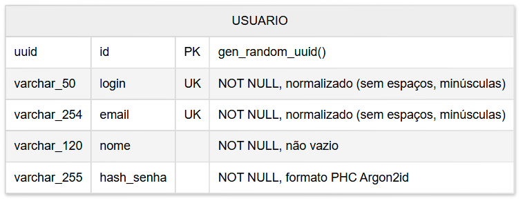

## 2.4 Modelo de dados

> **Item de informação IT-2.4** · Autoria: Júlia de Souza Nascimento · Revisão: Kesley Soares da Silva

O repositório de dados contém uma única entidade, `USUARIO`, suficiente para as etapas de validação (RF02) e comparação (RF03). A Figura 5 apresenta o modelo e a Tabela 12 o dicionário de dados.

**Figura 5 – Modelo entidade-relacionamento do repositório de usuários**



*Fonte: elaborada pelos autores (2026), com a ferramenta Mermaid [MERMAID, 2026].*

**Tabela 12 – Dicionário de dados da tabela usuario**

| Coluna | Tipo (PostgreSQL) | Restrições | Descrição |
|---|---|---|---|
| `id` | `uuid` | PK; padrão `gen_random_uuid()` | Identificador único e estável do usuário, retornado no objeto de identidade. |
| `login` | `varchar(50)` | `NOT NULL`; `UNIQUE`; `CHECK (login = lower(btrim(login)) AND login <> '')`; não contém `@` | Identificador de usuário. |
| `email` | `varchar(254)` | `NOT NULL`; `UNIQUE`; `CHECK (email = lower(btrim(email)) AND email <> '')` | Endereço de e-mail; 254 caracteres é o limite prático de um endereço [KLENSIN, 2008]. |
| `nome` | `varchar(120)` | `NOT NULL`; `CHECK (btrim(nome) <> '')` | Nome de exibição. |
| `hash_senha` | `varchar(255)` | `NOT NULL` | *Hash* Argon2id em formato PHC, incluindo parâmetros e sal individual. |

*Fonte: elaborada pelos autores (2026).*

As restrições `UNIQUE` criam automaticamente índices B-tree em `login` e `email`, o que torna as buscas por igualdade da [Seção 2.3](2.3-componentes.md#23-desenho-detalhado-de-componentes) eficientes [POSTGRESQL, 2026]. As restrições `CHECK` garantem que `login` e `email` sejam gravados exatamente na forma normalizada da RN02 (sem espaços nas extremidades e em minúsculas), pois um valor como `" julia "` nunca seria encontrado pela busca com o identificador normalizado `"julia"`. Como `NOT NULL` não impede cadeias vazias, as restrições também rejeitam `''` em `login`, `email` e `nome`. A restrição de `login` sem `@` garante que a RN01 nunca confunda um login com um e-mail. O script de criação é:

```sql
CREATE TABLE usuario (
    id          uuid         PRIMARY KEY DEFAULT gen_random_uuid(),
    login       varchar(50)  NOT NULL UNIQUE
                CHECK (login = lower(btrim(login)) AND login <> '' AND position('@' in login) = 0),
    email       varchar(254) NOT NULL UNIQUE
                CHECK (email = lower(btrim(email)) AND email <> ''),
    nome        varchar(120) NOT NULL CHECK (btrim(nome) <> ''),
    hash_senha  varchar(255) NOT NULL
);
```

A senha nunca é armazenada; armazena-se apenas o resultado de uma função de *hash* lenta e com uso intensivo de memória, de modo que, mesmo em caso de vazamento da tabela, o custo de descobrir as senhas por força bruta seja alto [OWASP, 2026b; BIRYUKOV et al., 2021]. O usuário de banco usado pela aplicação recebe somente o privilégio `SELECT` sobre a tabela, pois o software não grava dados.
