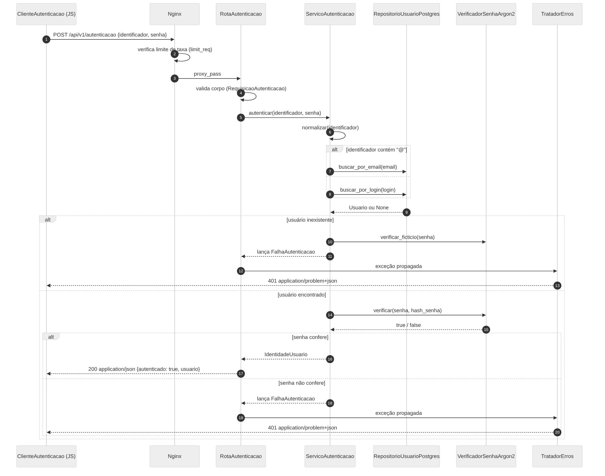
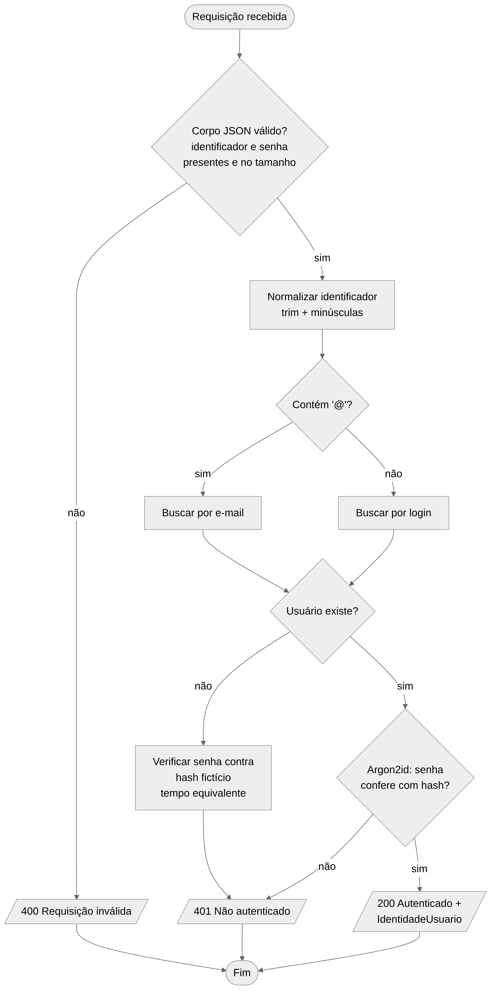

## 2.6 Comportamento dinâmico

> **Item de informação IT-2.6** · Autoria: Kesley Soares da Silva · Revisão: Verônica Ribeiro Oliveira Palmeira  
> Referências do item: [[OMG, 2017](../referencias.md#ref-omg2017)]; [[MERMAID, 2026](../referencias.md#ref-mermaid2026)]; [[OWASP, 2026a](../referencias.md#ref-owaspauth2026)] · Apoio de IA: [[ANTHROPIC, 2026](../referencias.md#ref-anthropic2026)]

Enquanto a [Seção 1.3](../01-ambiente/1.3-processamento.md#13-processamento-de-uma-requisição-web) descreve o processamento do ponto de vista do ambiente (navegador, servidores e protocolos), esta subseção descreve o mesmo processamento do ponto de vista dos componentes internos projetados na [Seção 2.3](2.3-componentes.md#23-desenho-detalhado-de-componentes). A Figura 6 é um diagrama de sequência UML [[OMG, 2017](../referencias.md#ref-omg2017)] com os três cenários possíveis após uma requisição bem formada: usuário inexistente, senha incorreta e sucesso.

**Figura 6 – Diagrama de sequência da autenticação**

*Fonte: elaborada pelos autores (2026), com a ferramenta Mermaid [[MERMAID, 2026](../referencias.md#ref-mermaid2026)].*

Dois aspectos do diagrama merecem destaque. Primeiro, a decisão de autenticação (RF04) acontece integralmente no `ServicoAutenticacao`; a rota apenas traduz o resultado para HTTP. Segundo, no cenário de usuário inexistente, o serviço executa `verificar_ficticio` antes de lançar a exceção. Sem essa chamada, a resposta para um identificador inexistente seria dezenas de milissegundos mais rápida do que para um identificador existente, porque não haveria cálculo do Argon2id; um atacante poderia medir essa diferença e descobrir quais identificadores estão cadastrados, anulando a RN04 [[OWASP, 2026a](../referencias.md#ref-owaspauth2026)].

A Figura 7 apresenta o algoritmo completo de decisão, incluindo a validação da entrada, na forma de um diagrama de atividades.

**Figura 7 – Diagrama de atividades da decisão de autenticação**

*Fonte: elaborada pelos autores (2026), com a ferramenta Mermaid [[MERMAID, 2026](../referencias.md#ref-mermaid2026)].*
